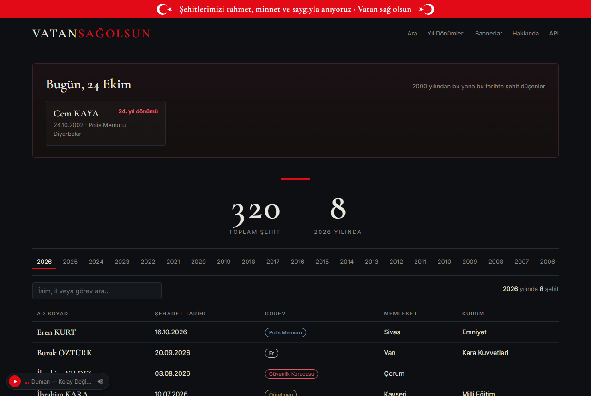
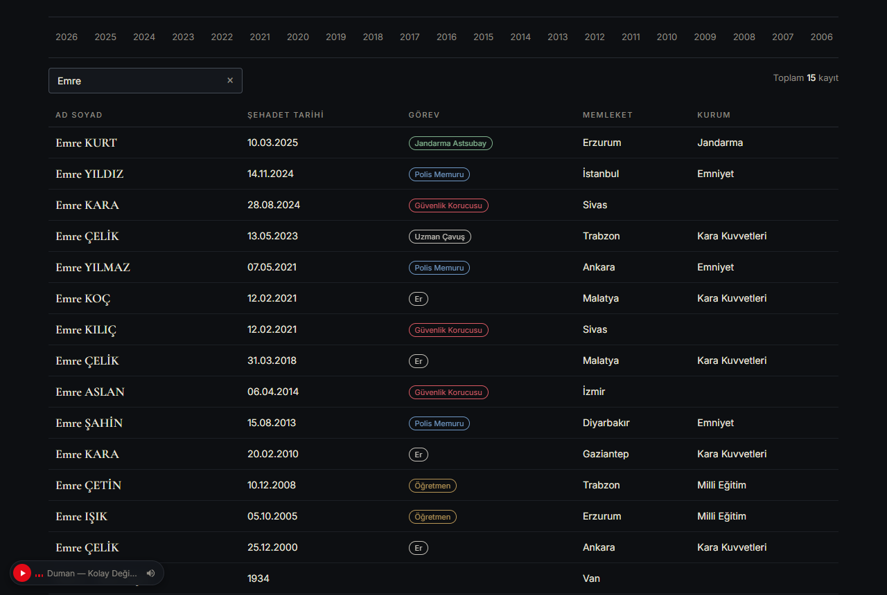
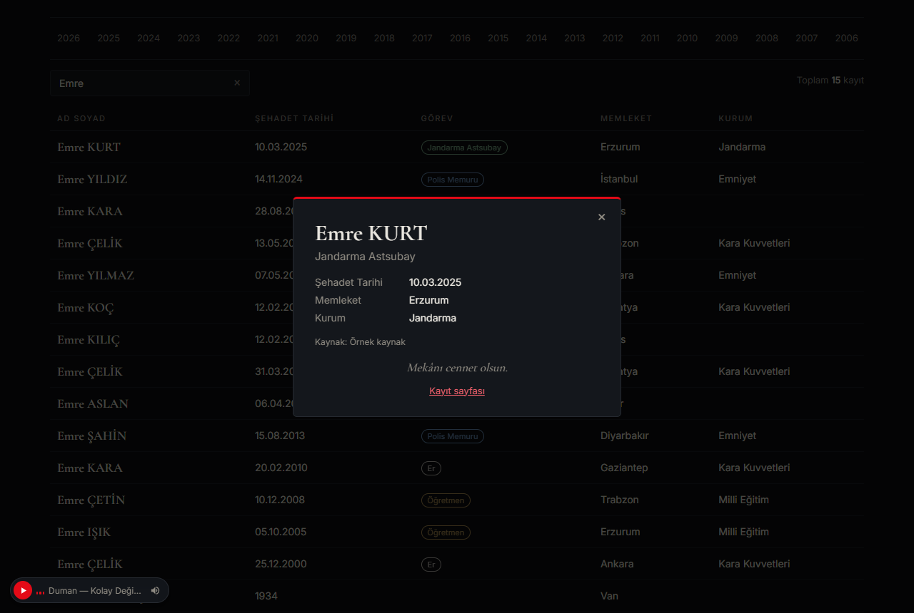
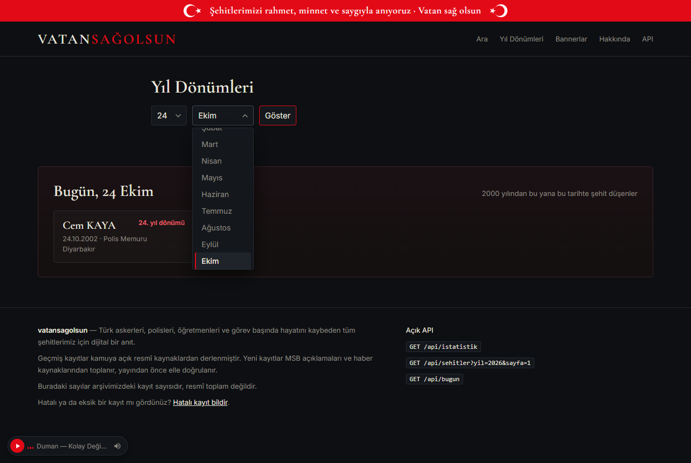
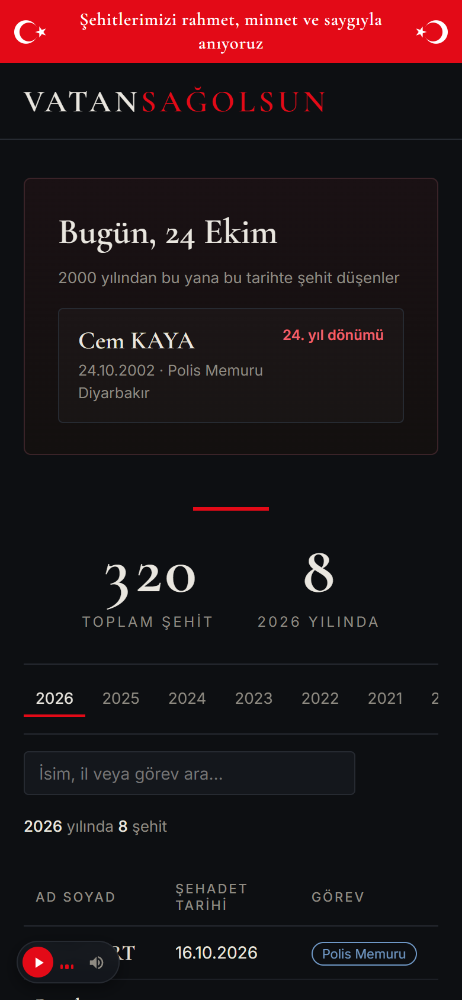

<div align="center">

# VATAN SAĞ OLSUN

**Şehitlerimiz için dijital bir anıt**

*Bastığın yerleri "toprak!" diyerek geçme, tanı:*<br>
*Düşün altındaki binlerce kefensiz yatanı.*<br>
— İstiklal Marşı, Mehmet Âkif Ersoy

<br>



</div>

---

## Bir isim, bir hayat, bir vatan

Bu topraklarda bir söz vardır: **"Her Türk asker doğar."** Bu söz savaşı övmek için söylenmez. Gerektiğinde vatanı için her şeyini verebilecek bir milletin sözüdür. Bu milletin evlatları Çanakkale'de, Sakarya'da, Kore'de, Kıbrıs'ta, dağ başlarında, karakollarda, sınır boylarında ve 15 Temmuz gecesi köprülerde bu sözün hakkını canlarıyla verdi.

Evladını toprağa veren bir anne ya da baba, acısının en derin yerinde çoğu zaman tek bir cümle kurar: **"Vatan sağ olsun."** Türkçenin en ağır ve en onurlu cümlelerinden biridir. Bu site adını o cümleden aldı.

**Vatan Sağ Olsun**, Türk askerlerini, polislerini, jandarmalarını, korucularını, öğretmenlerini ve görev başında hayatını kaybeden bütün şehitlerimizi **isim isim** anmak için kuruldu. Hiçbir isim bir rakama dönüşmesin, hiçbir fedakârlık unutulmasın, hiçbir yıl dönümü sessiz geçmesin diye.

> *Şehitler ölmez, vatan bölünmez.*

---

## Sözler

> *Sana dar gelmeyecek makberi kimler kazsın?*<br>
> *"Gömelim gel seni tarihe!" desem, sığmazsın.*
>
> — Mehmet Âkif Ersoy, *Çanakkale Şehitlerine*

> *Ey, bu topraklar için toprağa düşmüş asker!*<br>
> *Gökten ecdâd inerek öpse o pâk alnı değer.*
>
> — Mehmet Âkif Ersoy, *Çanakkale Şehitlerine*

> *Allah yolunda öldürülenlere "ölüler" demeyin. Hayır, onlar diridirler; fakat siz farkında olmazsınız.*
>
> — Bakara Sûresi, 154. âyet (meal)

> *Her Türk asker doğar.*
>
> — Halk sözü

---

## Görünüm

<table>
<tr>
<td width="50%"><br><b>Canlı arama.</b> İsim, il ya da görev yazdıkça liste yenilenir; yazı silinince kendiliğinden sıfırlanır.</td>
<td width="50%"><br><b>Şehit penceresi.</b> Bir isme tıklayınca açılır. Kaynakta varsa fotoğraf, şehadet yeri ve nasıl şehit düştüğü de burada görünür.</td>
</tr>
<tr>
<td width="50%"><br><b>Yıl dönümleri.</b> Herhangi bir günü seçin; o gün şehit düşenleri görün.</td>
<td width="50%" align="center"><br><b>Telefonda da</b> aynı özen.</td>
</tr>
</table>

<sub>Görüntülerdeki isimler deneme amaçlı üretilmiş <b>örnek verilerdir</b>; gerçek kişilere ait değildir.</sub>

---

## Neler var?

- **Anma bandı.** Her sayfanın en üstünde: *Şehitlerimizi rahmet, minnet ve saygıyla anıyoruz · Vatan sağ olsun.*
- **Bugün.** Ana sayfa, bugünün tarihinde şehit düşenleri ve kaçıncı yıl dönümü olduğunu gösterir.
- **Yıllara göre liste.** 2000'den bugüne her yıl için bir sekme, ayrıca "2000 öncesi" ve "Tümü".
- **Canlı arama.** Enter'a basmak gerekmez, aramayı silmek listeyi sıfırlar, **×** düğmesi ya da Esc tuşu temizler.
- **Şehit penceresi ve kayıt sayfası.** Görev, şehadet tarihi ve yeri, memleket, baba adı, kurum, fotoğraf, şehadet anlatımı ve kaynak bağlantıları.
- **Yıl dönümleri.** İstediğiniz günün şehitleri.
- **Bannerlar.** Başka sitelerin kendi sayfalarına ekleyebileceği anma bannerları (HTML, React, Vue, Svelte, Angular).
- **Webhooks.** Yeni bir şehidimiz yayına alındığında Discord kanallarına hazır bir kart, diğer adreslere JSON bildirimi gider. Eklenen her webhook önce sizin onayınızı bekler.
- **Hatalı kayıt bildirimi.** Eksik ya da yanlış bir kaydı herkes bildirebilir.
- **Açık API.** Anahtarsız ve ücretsiz: `/api/istatistik`, `/api/sehitler`, `/api/bugun`. Belgesi `/api/belgeler` adresinde.
- **Yönetici paneli.** Kayıtları onaylama, düzenleme, birleştirme; toplayıcıyı ve yapay zekâ sağlayıcılarını izleme.
- **Otomatik toplama.** Resmî sayfalar ve haber siteleri 30 dakikada bir taranır. **Hiçbir kayıt elle onaylanmadan yayına girmez.**

## Kayıtlar nereden geliyor?

Geçmiş kayıtlar, resmî kurumların kamuya açık verilerinden derlenen arşivlerden alınır: **Emniyet Genel Müdürlüğü**, **Sahil Güvenlik Komutanlığı**, **sehitlerimiz.org.tr**, **kahramanlar.org.tr** ve **15temmuzsehitleri.com**. Aynı kişi birden fazla kaynakta geçiyorsa tek kayıtta birleştirilir ve bütün kaynakları kaydın altında gösterilir.

Sitedeki sayı arşivimizdeki kayıt sayısıdır, **resmî toplam değildir**. Her bir isim bir hayattır; eksik ya da hatalı bir kayıt görürseniz lütfen sitedeki **Hatalı kayıt bildir** formunu kullanın.

---

# Kurulum ve işletme rehberi

Bu bölüm teknik bilgisi olmayan biri için yazıldı: komutları olduğu gibi kopyalayıp yapıştırmanız yeterli.

**İçindekiler:**
[1. Kendi bilgisayarınızda deneme](#1-kendi-bilgisayarınızda-deneme) ·
[2. Sunucu kiralama](#2-sunucu-vds-kiralama) ·
[3. Alan adı](#3-alan-adını-sunucuya-yönlendirme) ·
[4. Docker](#4-sunucuya-docker-kurma-ve-projeyi-kopyalama) ·
[5. `.env`](#5-env-dosyasını-doldurma) ·
[6. Başlatma](#6-siteyi-başlatma) ·
[7. Güncelleme](#7-güncelleme) ·
[8. Yedek](#8-yedek-alma) ·
[9. Geçmiş veriler](#9-geçmiş-verileri-aktarma) ·
[10. Otomatik toplama](#10-yeni-şehitleri-otomatik-toplama) ·
[11. Webhooklar](#11-webhooklar) ·
[Geliştiriciler](#geliştiriciler-için)

---

## 1. Kendi bilgisayarınızda deneme

Python 3.12 gerekir (https://www.python.org/downloads/).

```bash
python -m venv .venv
.venv/Scripts/pip install -e ".[dev]"      # Mac/Linux: .venv/bin/pip ...
.venv/Scripts/alembic upgrade head          # veritabanı tablolarını oluşturur
.venv/Scripts/python -m app.cli ornek-veri  # sahte örnek kayıtlar ekler
.venv/Scripts/uvicorn app.main:app
```

Tarayıcıda http://localhost:8000 adresini açın. Örnek kayıtları silmek için:
`.venv/Scripts/python -m app.cli ornek-veri --sil`

> Örnek veri gerçek değildir. Komut, gerçek (PostgreSQL) veritabanına yanlışlıkla örnek veri eklememeniz için `--eminim` yazmadıkça çalışmayı reddeder. Gerçek sitede bu komutu **kullanmayın**.

Yerelde yönetici paneli için `.env` dosyası gerekir (bkz. bölüm 5).

---

## 2. Sunucu (VDS) kiralama

Önerimiz **[White Bilişim](https://whitebilisim.com/)** VDS sunucuları. Sunucular **İstanbul'da** (Datacasa veri merkezi) olduğu için sitemiz Türkiye'deki ziyaretçilere hızlı açılır. Diskler NVMe, bağlantı 10 Gbit/s; her pakette DDoS koruması var.

| Paket | İşlemci | RAM | Aylık | Ne zaman? |
|---|---|---|---|---|
| **ENT-2** (Xeon) | 2 çekirdek | 4 GB | ₺240 | **Önerilen.** Site, veritabanı ve toplu aktarım rahatça çalışır. |
| ENT-1 (Xeon) | 2 çekirdek | 2 GB | ₺160 | En düşük bütçe. Çalışır ama `docker compose up --build` ve uzun aktarımlarda sıkışabilir. |
| PRO-1 (Ryzen) | 2 çekirdek | 4 GB | ₺400 | Daha hızlı işlemci isterseniz. Bu proje için şart değildir. |

> Fiyatlar Ekim 2026'da White Bilişim'in sayfalarında görülen fiyatlardır ve değişebilir. Satın almadan önce sipariş sayfasından güncel fiyatı ve disk boyutunu kontrol edin. Bu site için 20 GB disk bile yeter.

Kiralama adımları:

1. https://whitebilisim.com/ adresinde hesap açın ve **Xeon VDS** sayfasından **ENT-2** paketini seçin.
2. İşletim sistemi olarak **Ubuntu 24.04** seçin (listede yoksa en yeni **Ubuntu LTS** sürümünü seçin).
3. Ödeme tamamlanınca sunucunun **IP adresi** ve **root şifresi** müşteri panelinize ve e-postanıza gelir. IP adresini not alın (örnek: `203.0.113.10`).

> VDS sunucular "yönetimsiz" olarak verilir: sunucunun kurulumu ve güncellenmesi size aittir. Bu rehberdeki adımlar tam olarak bunun içindir. White Bilişim'in sunduğu ücretsiz günlük yedeğe güvenmeyin, "en iyi çaba" esasıyla verilir. Bölüm 8'deki veritabanı yedeğini siz de alın.

## 3. Alan adını sunucuya yönlendirme

Alan adını aldığınız firmanın (GoDaddy, Natro, Cloudflare vb.) DNS ayarlarına girin ve şu kayıtları ekleyin:

| Tür | Ad | Değer |
|-----|----|-------|
| A | `@` (ya da boş) | sunucunun IP adresi |
| A | `www` | sunucunun IP adresi |

Değişikliğin yayılması birkaç dakika ile birkaç saat sürebilir. HTTPS sertifikası, alan adı sunucuya ulaştığında otomatik alınır.

## 4. Sunucuya Docker kurma ve projeyi kopyalama

Bilgisayarınızdan sunucuya bağlanın: `ssh root@203.0.113.10`

```bash
curl -fsSL https://get.docker.com | sh      # Docker'ı kurar
apt-get install -y git
git clone <PROJENİN-GITHUB-ADRESİ> vatansagolsun
cd vatansagolsun
```

## 5. `.env` dosyasını doldurma

```bash
cp .env.example .env
nano .env        # kaydet: Ctrl+O, Enter; çık: Ctrl+X
```

Doldurmanız gerekenler:

- `ALAN_ADI` ve `SITE_URL`: kendi alan adınız (`ornek.com` / `https://ornek.com`).
- `OTURUM_HTTPS=true`: olduğu gibi bırakın (sunucuda HTTPS ile çalışır). Yalnızca bilgisayarınızda HTTP ile deneyecekseniz `OTURUM_HTTPS=false` yazın (ya da satırı silin).
- `SECRET_KEY`: **en az 32 rastgele karakter olmalıdır.** Kısa kalırsa ya da `degistir` olarak bırakılırsa **yönetici paneli kilitli kalır**. Üretmek için:

  ```bash
  python3 -c "import secrets; print(secrets.token_urlsafe(48))"
  ```

  Çıkan metni `SECRET_KEY=` satırına yapıştırın. (Bilgisayarınız Windows ise `python` yazın.)
- `POSTGRES_PASSWORD`: uzun bir şifre yazın (yalnızca harf ve rakam kullanın).
- `ADMIN_KULLANICI`: panele girişte kullanacağınız ad.
- `ADMIN_SIFRE_HASH`: panel şifrenizin güvenli (şifrelenmiş) hâli. Şifrenizi **düz yazmayın**; şu komutla üretin:

  ```bash
  docker compose run --rm app python -m app.cli sifre-olustur
  ```

  (Bilgisayarda deniyorsanız: `.venv/Scripts/python -m app.cli sifre-olustur`.) Şifrenizi iki kez sorar ve şuna benzer bir satır basar:

  ```
  ADMIN_SIFRE_HASH='$2b$12$abc...'
  ```

  Bu satırı **tek tırnaklarla birlikte, olduğu gibi** `.env` içindeki `ADMIN_SIFRE_HASH=` satırının yerine yapıştırın. Tek tırnaklar önemlidir: Docker Compose, tırnaksız `$` işaretini değişken sanıp şifreyi bozar. Tek tırnaklı hâli hem Docker'da hem yerel çalıştırmada doğru çalışır.

`.env` dosyasını kimseyle paylaşmayın, GitHub'a yüklemeyin.

## 6. Siteyi başlatma

```bash
docker compose up -d --build
```

İlk seferde birkaç dakika sürer. Bittiğinde `https://alanadiniz.com` açılır. Kontrol için `curl https://alanadiniz.com/api/istatistik` komutu bir sayı döndürmelidir. Veritabanı tablolarını uygulama açılırken kendisi oluşturur ve günceller.

**Panele giriş:** `https://alanadiniz.com/panel` adresine gidin; `.env` içindeki kullanıcı adı ve (hash'i üretirken yazdığınız) şifreyle girin. Giremiyorsanız `SECRET_KEY` değerinin en az 32 karakter olup olmadığına bakın.

Logları görmek için: `docker compose logs -f app`

## 7. Güncelleme

```bash
cd vatansagolsun
git pull && docker compose up -d --build
```

## 8. Yedek alma

Veritabanının yedeğini düzenli olarak (örneğin haftada bir) alın:

```bash
docker compose exec -T db pg_dump --clean --if-exists -U vatansagolsun vatansagolsun > yedek-$(date +%F).sql
```

Yedeği geri yüklemek için önce uygulamayı durdurun, yedeği yükleyin, sonra yeniden başlatın:

```bash
docker compose stop app
docker compose exec -T db psql -U vatansagolsun vatansagolsun < yedek-2026-01-01.sql
docker compose start app
```

Yedek dosyasını sunucudan başka bir yere (örneğin kendi bilgisayarınıza) kopyalamayı unutmayın.

---

## 9. Geçmiş verileri aktarma

Site, kamuya açık resmî arşivlerden geçmiş şehit kayıtlarını kendisi toplayabilir:

| Kod | Kaynak |
|---|---|
| `egm` | Emniyet Genel Müdürlüğü |
| `sg` | Sahil Güvenlik Komutanlığı |
| `kahramanlar` | kahramanlar.org.tr (2000 öncesi) |
| `sehitlerimiz` | sehitlerimiz.org.tr (2000 sonrası) |
| `temmuz15` | 15temmuzsehitleri.com (15 Temmuz şehitleri) |

Siteler, her istek arasında en az 2 saniye beklenerek, sunucularını yormadan taranır.

### Kaynakları açıp kapatma

`.env` içindeki `KAYNAK_IZINLERI` satırı hangi kaynaklardan veri alınacağını belirler:

```
KAYNAK_IZINLERI=["egm","sg","kahramanlar","sehitlerimiz","temmuz15","hurriyet","sabah","aa","trt"]
```

Bir site itiraz ederse o kaynağın adını listeden **çıkarın** ve `docker compose up -d` çalıştırın; o kaynağa artık hiç istek gitmez. O kaynaktan gelmiş kayıtları API'den de gizlemek isterseniz adını `API_HARIC_KAYNAKLAR=["sehitlerimiz"]` satırına yazın.

### Komutlar

```bash
docker compose exec app python -m app.cli aktar hepsi     # tüm kaynakları sırayla aktarır
docker compose exec app python -m app.cli aktar egm       # tek kaynak: egm | sg | kahramanlar | sehitlerimiz | temmuz15
docker compose exec app python -m app.cli aktarim-durumu  # her kaynak için sayılar ve son durum
```

Toplu aktarımla gelen kayıtlar doğrudan yayına girer. Aynı kayıt iki kez eklenmez; komutu tekrar çalıştırmak güvenlidir.

### Fotoğraf ve şehadet ayrıntısı

Şehit penceresinde ve kayıt sayfasında, kaynak veriyorsa fotoğraf, şehadet yeri ve "Şehadeti" (nasıl şehit düştüğü) bölümü de gösterilir:

| Kaynak | Fotoğraf | Şehadet yeri | Şehadeti |
|---|---|---|---|
| `temmuz15` | ✓ | ✓ | ✓ (biyografi, son tam cümlede kesilir) |
| `egm` | ✓ (tek kişilik kartlar) | | |
| `sg` | ✓ | | |
| `sehitlerimiz` | | ✓ | |
| haber taraması | | | ✓ (yapay zekâ olay özeti) |

Fotoğraflar kaynağın kendi sunucusundan gösterilir; açılmayan fotoğraf gizlenir. Yönetici panelinde her kayıt için bu üç alan elle de girilebilir. Bu özellikten önce aktarılmış kayıtlar için kaynağı baştan okuyun. Bu sırada yalnızca bu üç alandan boş olanlar doldurulur, başka hiçbir alana dokunulmaz:

```bash
docker compose exec app python -m app.cli aktar temmuz15 --bastan
docker compose exec app python -m app.cli aktar egm --bastan
docker compose exec app python -m app.cli aktar sg --bastan
```

### Ne kadar sürer?

- `egm`, `sg` ve `temmuz15`: birkaç dakika.
- `kahramanlar`: yaklaşık 1.850 istek × 2 saniye, yani **yaklaşık 1 saat**.
- `sehitlerimiz`: 2000 sonrası her kaydın kendi sayfası alınır. Bu yüzlerce, hatta binlerce istek demektir ve **saatler sürebilir**.

Komut yarıda kesilirse (bağlantı koptu, Ctrl+C'ye basıldı, sunucu yeniden başladı) **aynı komutu tekrar çalıştırın**; kaldığı yerden devam eder. Uzun işlerin bağlantınız kopsa da sürmesi için onları arka planda çalıştırın:

```bash
docker compose exec -d app python -m app.cli aktar hepsi
```

(`-d`: arka planda çalıştırır.) İlerlemeyi `aktarim-durumu` ile izleyin.

### 12 saatlik otomatik kontrol

`sehitlerimiz` kaynağı açıkken site, 12 saatte bir sehitlerimiz.org.tr'nin "son eklenenler" listesine bakar (sunucu açıldıktan 5 dakika sonra ilk kontrol yapılır). Yeni bir kayıt bulursa onu **yayına almaz**; kayıt yönetici panelinde **onay bekleyenler** arasına düşer ve siz onaylayınca yayınlanır. Elle tek seferlik çalıştırmak için:

```bash
docker compose exec app python -m app.cli sehitlerimiz-kontrol
```

> Toplu aktarım (`aktar sehitlerimiz` ya da `aktar hepsi`) sürerken `sehitlerimiz-kontrol` komutunu elle çalıştırmayın: ikisi aynı siteye aynı anda istek atar ve aynı kayıtları farklı durumlarla (toplu aktarım yayında, kontrol onay bekliyor) almaya çalışır. Aktarım bitince çalıştırın.

İlk çalıştırmada kontrol yalnızca "şu an sitedeki en son kayıt" noktasını işaretler, geçmişi getirmez (geçmiş için yukarıdaki `aktar` komutu vardır). Bu kontrol `docker-compose.yml` içindeki `ZAMANLAYICI_AKTIF=true` ayarıyla çalışır; yerelde kapalıdır.

> Uygulama Docker'da **tek** süreç olarak çalışır. `uvicorn`'a `--workers` ekleyip birden fazla süreç çalıştırırsanız her süreç kendi zamanlayıcısını başlatır ve kontrol birden fazla kez yapılır.

### Excel ile toplu ekleme

Elinizde bir isim listesi varsa (ör. bir haber sitesinin derlediği liste) yönetici panelinde **Toplu ekle** sekmesini kullanın:

1. **Boş şablonu indir** düğmesiyle şablonu alın. İlk satır başlıktır, yalnızca **Ad** zorunludur. Diğer sütunlar: Soyad, Görev, Kategori, Kurum, Memleket, Şehadet tarihi (GG.AA.YYYY ya da yalnız yıl), Şehadet yeri, Şehadet olayı, Doğum yılı, Baba adı, Dönem, Fotoğraf URL, Kaynak URL (birden çok olabilir), Not. Sütunların sırası önemli değildir.
2. Dosyayı seçin. Yeni kayıtların **onay bekliyor** olarak mı yoksa **doğrudan yayında** mı ekleneceğini seçip **Yükle ve ekle**'ye basın.
3. Sayfa kaç kaydın eklendiğini, kaçının sitede zaten olduğunu ve hangi satırların neden eklenemediğini (satır numarasıyla) gösterir.

- Sitede zaten olan kişi yeniden eklenmez, yalnızca boş bilgileri doldurulur; resmî kaynaktan gelen bilgi ezilmez.
- Aynı adı taşıyan ama rütbesi ya da kurumu açıkça farklı (ör. polis ile er, astsubay ile uzman çavuş) iki kişi birleştirilmez.
- **Aynı dosyayı yeniden yüklemek güvenlidir:** önceki satırlar yeni kayıt açmaz, yalnızca kayıtta boş kalan bilgileri doldurur. Böylece önce yalnızca isimlerle bir liste yükleyip bilgiler bulundukça güncel dosyayı yeniden yükleyebilirsiniz. Bunun için satırdaki **ad, soyad ve görevi değiştirmeyin**; yazım düzeltmesini panelde yapın.
- "Not" ve (varsa) "Güven" sütunu panelde kaynağın altında görünür, sitede gösterilmez.
- Kayıtlar resmî teyitsiz sayılır. Doğrudan yayına alınan ve şehadeti son 7 gün içinde olan kayıtlar webhooklara duyurulur.

**Toplu onay:** Onay bekleyenler sayfasında her kaydın yanında bir seçim kutusu vardır. Üstteki çubuktan **Tümü**, **Güveni yüksek** ya da **Yüksek + orta** ile seçip **Seçilenleri onayla** veya **Seçilenleri reddet** düğmesine basın; işlemden önce kaç kayıt etkileneceği sorulur.

2015'te başlayan hendek operasyonları dönemine ait 722 isimlik liste (`veri/hendek-2015.txt`) iki dosyaya ayrılmıştır:

- `veri/hendek-2015.xlsx`: internette araştırılan 188 kişi. Bulunanların ayrıntıları kaynak linkleriyle doldurulmuştur. "Güven" sütunu: **yüksek**, **orta** ya da **bulunamadı** (arandı, uygun kişi çıkmadı; yalnızca isim ve rütbe).
- `veri/hendek-2015-kalan.txt`: henüz araştırılmamış 534 isim, özgün listeyle aynı biçimde ("ŞEHİT RÜTBE AD SOYAD").

---

## 10. Yeni şehitleri otomatik toplama

Site **30 dakikada bir** (sunucu açıldıktan 2 dakika sonra ilk tur) yeni şehit haberlerini kendisi arar. Bunun için `.env` içinde `ZAMANLAYICI_AKTIF=true` olmalıdır (`docker-compose.yml` bunu zaten açar). Her tur şunlara bakar:

- **Resmî sayfalar:** Emniyet (`egm`) ve Sahil Güvenlik (`sg`) sitelerinin en yeni kayıtları.
- **Haber siteleri:** **Hürriyet**, **Sabah**, **Anadolu Ajansı** (`aa`) ve **TRT Haber** (`trt`). Bu sitelerin haber akışında şehitlikle ilgili haberler yapay zekâyla (OpenAI, Gemini veya Claude) okunur; haberde geçen şehitlerin adı, görevi ve şehadet tarihi çıkarılır. Her haber yalnızca bir kez okunur.

> **Önceden kurulmuş bir sunucuda** `.env` dosyanızda `KAYNAK_IZINLERI` satırı varsa AA ve TRT kendiliğinden açılmaz: satırın sonuna `"aa","trt"` ekleyin (yukarıdaki bölüm 9'daki örnek gibi) ve `docker compose up -d` çalıştırın. Satır hiç yoksa bir şey yapmanız gerekmez.

**Toplayıcı hiçbir kaydı kendi başına yayına almaz.** Bulduğu her yeni kayıt panelde **onay bekleyenler** arasına düşer; siz bakıp onaylayınca yayınlanır.

### Yapay zekâ analizi (OpenAI, Gemini, Claude)

Haberleri okumak için en az bir yapay zekâ anahtarı gerekir. Üç sağlayıcı desteklenir ve **sırayla** denenir: önce **OpenAI**, o kullanılamazsa **Gemini**, o da olmazsa **Claude**. Hepsini girmeniz gerekmez; anahtarını girdiğiniz sağlayıcılar kullanılır, anahtarı olmayanlar atlanır. Hiç anahtar yoksa haber analizi yapılmaz, yalnızca resmî sayfalar taranır. Bu durumda panelde "API anahtarı yok" ve "Toplayıcıda hata var" uyarıları görünür; bu beklenen bir durumdur ve anahtar ekleyince kaybolur.

**1. OpenAI (ücretli, kullandıkça kredi düşer)**

1. https://platform.openai.com adresinde hesap açın, **Billing** bölümünden kredi yükleyin.
2. **API keys** bölümünden yeni bir anahtar oluşturup kopyalayın (yalnızca bir kez gösterilir).
3. `.env` dosyasına yapıştırın: `OPENAI_API_KEY=sk-...`

Dikkat: ChatGPT uygulamasındaki abonelik ya da bakiye API'de **geçmez**. API için platform.openai.com'a ayrıca kredi yüklemeniz gerekir.

**2. Gemini (ücretsiz katmanı var)**

1. https://aistudio.google.com adresine Google hesabınızla girin, **Get API key** düğmesiyle anahtar oluşturun.
2. `.env` dosyasına yapıştırın: `GEMINI_API_KEY=...`

Ücretsiz katmanın günlük bir sınırı vardır; kalan hakkınızı AI Studio'da görebilirsiniz. Sınır dolunca Gemini "tükendi" sayılır ve günlük hak sıfırlanana dek (Pasifik saatiyle gece yarısı, Türkiye saatiyle kabaca 10:00) denenmez. Ücretsiz katmanda gönderilen metinler Google tarafından ürün geliştirmede kullanılabilir; ancak gönderilenler zaten herkese açık haber metinleridir.

**3. Claude**

1. https://console.anthropic.com adresinde hesap açın, faturalandırma bilgisi ekleyin.
2. **API Keys** bölümünden yeni bir anahtar oluşturup kopyalayın (yalnızca bir kez gösterilir).
3. `.env` dosyasına yapıştırın: `ANTHROPIC_API_KEY=sk-ant-...`

Anahtarları ekledikten sonra `docker compose up -d` ile yeniden başlatın. `GOOGLE_API_KEY` ve `ANTHROPIC_AUTH_TOKEN` ayar dosyasından değil, gerçek ortam değişkenlerinden okunur (Docker, `.env` içeriğini kapsayıcıya aktarır). Anahtarları kimseyle paylaşmayın; panelde de gösterilmezler, yalnızca "var" ya da "yok" yazar.

**Sırayı değiştirmek:** `.env` dosyasındaki `ANALIZ_SIRASI` satırını düzenleyin; örneğin Claude'u öne almak için `ANALIZ_SIRASI=["claude","openai","gemini"]`. Her sağlayıcının modeli `OPENAI_MODELI`, `GEMINI_MODELI` ve `ANALIZ_MODELI` (Claude) ayarlarıyla değiştirilebilir. Varsayılanlar ucuz modellerdir; değiştirmeniz gerekmez.

**Otomatik geçiş nasıl çalışır?** Bir haber için sağlayıcılar sırayla denenir.

- **Geçici sorun** (internet kesintisi, yoğunluk): aynı haber sıradaki sağlayıcıya verilir. Geçici hatalar sağlayıcıyı tükenmiş saymaz; son geçici hata ve zamanı tabloda "son hata" olarak görünür.
- **Kredi ya da günlük hak bitti, anahtar geçersiz:** panelde **"tükendi"** yazar. Sistem o sağlayıcıyı panelde yazan zamana kadar denemez ve haberleri sıradakilere verir. Tükenme süresi 24 saattir; Gemini'nin günlük hakkı bittiyse bir sonraki günlük sıfırlanmaya kadar sürer. Süre dolunca sistem kendiliğinden tekrar dener.
- **Kredi yüklediyseniz** beklemeniz gerekmez: panelde ilgili sağlayıcının yanındaki **"Yeniden dene"** düğmesi tükenmeyi hemen kaldırır.
- **Model adı yanlışsa** ya da model desteklenmiyorsa sağlayıcı yine "tükendi" görünür (ileti: "model bulunamadı veya desteklenmiyor"). `.env` içindeki model adını düzeltip **"Yeniden dene"** düğmesine basın.
- **Tüm sağlayıcılar tükenmişse** haberler bekletilir; kredi yükleyince ya da süre dolunca işlenir.

**Tahmini maliyet:** günde birkaç düzine haber okunur ve ucuz modeller kullanılır. Olağan bir ayda maliyet birkaç doların altında kalır; Gemini'nin ücretsiz katmanı yetiyorsa hiç ödemeyebilirsiniz. Güvenlik için günlük okuma sayısı `GUNLUK_ANALIZ_SINIRI` (varsayılan 200) ile sınırlıdır; her haber bir sayılır.

**Üst sınır:** yoğun bir dönemde her gün 200 sınırına ulaşılırsa ve haberler uzunsa, ücretli sağlayıcılarda aylık maliyet **onlarca dolara** çıkabilir. Daha düşük bir tavan için `.env` dosyasında `GUNLUK_ANALIZ_SINIRI` değerini küçültün (örneğin `GUNLUK_ANALIZ_SINIRI=50`) ve `docker compose up -d` ile yeniden başlatın. Sınır dolunca o günün kalan haberleri ertesi güne kalır (3 güne kadar telafi edilir). Ayrıca sağlayıcıların sitelerinde aylık harcama limiti koymanızı öneririz.

### Panelde izleme

Paneldeki **Toplayıcı** sekmesi her kaynağın son çalışma zamanını, durumunu ve kaç kayıt eklediğini gösterir; bugün kaç haberin okunduğunu da yazar. **Analiz sağlayıcıları** tablosu her sağlayıcının sırasını, anahtarının olup olmadığını (anahtarın kendisi görünmez), modelini, durumunu ("kullanılabilir" ya da "tükendi — ... kadar") ve son başarılı kullanımını gösterir.

**Şimdi çalıştır** düğmesi turu beklemeden başlatır (bir tur zaten sürüyorsa "Toplayıcı zaten çalışıyor; bittiğinde tekrar deneyin" yazar). Eklenen, Birleşen, Atlanan ve Hatalı sütunları ilk çalışmadan bu yana **toplam** sayılardır. Toplayıcıda hata varsa ana panelin üstünde kısa bir uyarı çıkar. Zamanlayıcı kapalıysa toplayıcıyı elle çalıştırın:

```bash
docker compose exec app python -m app.cli topla
```

### Rozetler

- **Resmî teyit yok:** kayıt yalnızca haberden çıkarıldı; haberde resmî bir kurumun (bakanlık, Emniyet vb.) açıklaması geçmiyor. Onaylamadan önce kaynağı kontrol edin.
- **İsimsiz:** haber şehit olduğunu söylüyor ama isimler henüz açıklanmamış. Kayıt tek bir "İsimsiz" taslağı olarak gelir. İsimler açıklanınca kaydı düzenleyip adı yazabilir ya da gerçek kayıtla birleştirebilirsiniz.

### Bilmeniz gerekenler

- Emniyet ve Sahil Güvenlik sayfaları, o kaynağın **toplu aktarımı yapılmadan taranmaz** (aksi hâlde yüzlerce eski kayıt onay bekleyenlere düşerdi). Önce bölüm 9'daki `aktar egm` ve `aktar sg` komutlarını çalıştırın; o zamana kadar durum "önce aktar çalıştırın" yazar.
- Sunucu bir süre kapalı kalırsa toplayıcı, açıldığında **en fazla 3 gün** geriye giderek kaçırılan haberleri telafi eder.
- X (Twitter) hesapları kaynak olarak **kullanılmaz**: X otomatik okumaya izin vermiyor ve ücretli API gerektiriyor. Ayrıca doğrulanmamış paylaşımlar bu site için güvenilir değildir.

---

## 11. Webhooklar

Ziyaretçiler sitedeki **Webhooks** sayfasından (`/webhooks`) bir adres bırakabilir. Yeni bir şehidimiz yayına alındığında o adrese bildirim gider:

- **Discord webhook adresi** (`https://discord.com/api/webhooks/…`) ise hazır bir Discord kartı gönderilir: üstte "Şehidimiz var" mesajı; kartta yazar (Vatan Sağ Olsun), şehidin rütbesi ve adı, nasıl şehit düştüğü, şehadet tarihi, yeri, memleketi ve kurumu; **büyük görsel olarak Türk bayrağı**, **küçük görsel olarak şehidin fotoğrafı** (varsa) ve anma yazılı alt bilgi.
- **Başka bir adres** ise şehit bilgileri JSON nesnesi olarak `POST` edilir. İstek, webhook'a özel bir anahtarla imzalanır (`X-Vatansagolsun-Imza` başlığı); ayrıntılar ve örnek gövde Webhooks sayfasında.

**Ne zaman gider?** Yalnızca siz panelde bir kaydı onaylayıp yayına aldığınızda ve şehadet tarihi **son 7 gün içindeyse**. Toplu aktarımla gelen geçmiş kayıtlar, yılı belli olup tarihi belli olmayan kayıtlar ve "İsimsiz" kayıtlar duyurulmaz. Her kayıt **yalnızca bir kez** duyurulur; yayından kaldırıp yeniden onaylasanız da ikinci kez gitmez.

**Onay:** Eklenen her webhook paneldeki **Webhooklar** sekmesine **onay bekliyor** olarak düşer. Siz onaylayana kadar o adrese hiçbir istek gönderilmez. **Onayla** düğmesine basınca adrese bir deneme mesajı gider; başarılıysa webhook aktif olur, başarısızsa hata yazılır ve onay bekliyor olarak kalır. Aynı sekmeden webhook'ları durdurabilir, reddedebilir ya da silebilirsiniz. Discord adreslerindeki gizli anahtar panelde de gösterilmez.

**Deneme şehit mesajı:** Her webhook'un yanındaki **Deneme şehit mesajı gönder** düğmesi, gerçek bir yeni şehit duyurusunun aynısını gönderir; böylece kartın nasıl göründüğünü kendi kanalınızda görürsünüz. Mesaj "🧪 Deneme mesajı — gerçek bir duyuru değildir" diye başlar; JSON adreslerinde olay adı `yeni_sehit_deneme` olur ki karşı taraf bunu gerçek kayıt olarak işlemesin. Kayıt no boş bırakılırsa uydurma bir örnek kayıt kullanılır; şehidin fotoğrafının küçük görselde nasıl durduğunu görmek için fotoğrafı olan bir kaydın numarasını yazın. Deneme, webhook'u onaylamaz ve kaydı "duyuruldu" saymaz.

**Kendiliğinden kapanma:** Discord'da silinmiş bir webhook ya da art arda 5 kez ulaşılamayan bir adres kendiliğinden kapatılır ("Kendiliğinden kapananlar"); isterseniz **Yeniden etkinleştir** düğmesiyle açarsınız.

**Silme:** Webhook'u ekleyen kişiye bir kez **silme anahtarı** gösterilir; Webhooks sayfasının altındaki formdan bu anahtarla kendi webhook'unu silebilir.

**Güvenlik:** Yalnızca `https://` adresleri kabul edilir. Yerel ya da özel ağa (ör. `127.0.0.1`, `10.x.x.x`, `192.168.x.x`, bulut meta veri adresi) çözülen adresler hem eklenirken hem gönderirken reddedilir; istek, doğrulanan IP adresine sabitlenerek atılır ve yönlendirmeler izlenmez. Form IP başına dakikada 5 istekle sınırlıdır ve en fazla 200 webhook aynı anda onay bekleyebilir.

> **Önemli:** Discord'daki görseller (bayrak ve simge) sitenizden yüklenir. `.env` içindeki `SITE_URL` gerçek alan adınız olmalıdır (ör. `https://ornek.com`); `localhost` kalırsa Discord görselleri gösteremez.

---

## Geliştiriciler için

- Testler: `.venv/Scripts/python -m pytest`
- API belgesi: `/api/belgeler`
- İstek sınırı IP başınadır (`ISTEK_SINIRI`). Uygulama yalnızca Caddy arkasında çalıştırılır ve `X-Forwarded-For` başlığına güvenir; uygulama portunu (8000) internete açmayın.
- Ekran görüntüleri `docs/ekran/` klasöründedir ve örnek veriyle alınmıştır.

---

<div align="center">

*Bu vatan, uğrunda can verenlerin emanetidir.*

**Şehitlerimizi rahmet, minnet ve saygıyla anıyoruz.**<br>
**Mekânları cennet olsun. Vatan sağ olsun.**

</div>
